# Práctica 2: Configuración de un Servidor DNS paso a paso con BIND9 y Vagrant

**Módulo:** Despliegue de Aplicaciones Web (DAW2)  
**Autor:** Adrián Fernández  
**Entorno de Despliegue:** Vagrant (`debian/bookworm64`) & VirtualBox  
**Dominio de Pruebas:** `adrian.test`  
**Red Privada:** `192.168.57.0/24` | **IP Servidor:** `192.168.57.10`  

---

## Tabla de Contenidos
1. [Objetivos y Resultados de Aprendizaje (RA.5)](#1-objetivos-y-resultados-de-aprendizaje-ra5)
2. [Estructura del Proyecto y Control de Versiones](#2-estructura-del-proyecto-y-control-de-versiones)
3. [Infraestructura como Código (Vagrantfile)](#3-infraestructura-como-código-vagrantfile)
4. [Instalación del Servidor DNS BIND9](#4-instalación-del-servidor-dns-bind9)
5. [Configuración General y de Seguridad (named.conf.options)](#5-configuración-general-y-de-seguridad-namedconfoptions)
6. [Declaración de Zonas Directa e Inversa (named.conf.local)](#6-declaración-de-zonas-directa-e-inversa-namedconflocal)
7. [Archivos de Zona DNS y Registros](#7-archivos-de-zona-dns-y-registros)
8. [Comprobación de Sintaxis y Carga del Servicio](#8-comprobación-de-sintaxis-y-carga-del-servicio)
9. [Comprobación de Resoluciones con dig y nslookup](#9-comprobación-de-resoluciones-con-dig-y-nslookup)
10. [Tareas de Ampliación](#10-tareas-de-ampliación)
    - [10.1. Registro CNAME (Alias Web)](#101-registro-cname-alias-web)
    - [10.2. Registro Descriptivo TXT (Autor)](#102-registro-descriptivo-txt-autor)
    - [10.3. Resolución Inversa PTR](#103-resolución-inversa-ptr)
    - [10.4. Comprobación de Autoridad (Flag aa)](#104-comprobación-de-autoridad-flag-aa)
11. [Script de Autocomprobación (test.sh) y Despliegue Completo](#11-script-de-autocomprobación-testsh-y-despliegue-completo)
12. [Conclusiones](#12-conclusiones)

---

## 1. Objetivos y Resultados de Aprendizaje (RA.5)

Esta práctica evalúa el **Resultado de Aprendizaje 5 (RA.5)**: *Verifica la ejecución de aplicaciones Web comprobando los parámetros de configuración de servicios de red*.

### Criterios evaluados:
- **Criterio 1: Estructura, nomenclatura y funcionalidad de los sistemas de nombres jerárquicos.**
  - El DNS (*Domain Name System*) es una base de datos distribuida y jerárquica organizada en árbol invertido.
  - La raíz se representa mediante un punto (`.`). Por debajo se encuentran los **TLD** (*Top-Level Domains*), que pueden ser genéricos (`.com`, `.org`, `.test`) o territoriales (`.es`, `.fr`). En el siguiente nivel se encuentran los dominios de segundo nivel (por ejemplo, `adrian.test`) y los nombres de host/FQDN (`debian.adrian.test`).
  - La resolución puede ser **recursiva** (el servidor DNS local consulta a otros servidores hasta obtener la respuesta final y devolvérsela al cliente) o **iterativa** (el servidor devuelve referencias al siguiente nivel de autoridad si no conoce la respuesta directa).
  - Los tipos de registros DNS esenciales utilizados son:
    - **SOA (Start of Authority):** Define los parámetros de la zona autoritativa, servidor primario, email del administrador y temporizadores de sincronización (serial, refresh, retry, expire, TTL negativo).
    - **NS (Name Server):** Asigna los servidores DNS autoritativos de la zona.
    - **A (Address):** Asocia un nombre de host (FQDN) a una dirección IPv4.
    - **PTR (Pointer):** Mapeo inverso de una dirección IP hacia su nombre canónico FQDN (utilizando el dominio especial `in-addr.arpa`).
    - **CNAME (Canonical Name):** Define un alias o nombre alternativo hacia un registro A canónico existente.
    - **TXT (Text):** Almacena texto legible por humanos o metadatos de validación/seguridad (como SPF o titularidad del dominio).
- **Criterio 2: Identificación de las necesidades de configuración del servidor de nombres según requerimientos de aplicaciones Web.**
  - Las aplicaciones web desplegadas en entornos empresariales o de laboratorio requieren resolución de nombres consistente e independiente de las IPs físicas, lo que permite el balanceo de carga, la migración de servidores sin interrumpir el servicio y el uso de *Virtual Hosts* basados en nombre (por ejemplo, acceder a `web.adrian.test` en lugar de una IP fija).
- **Criterio 7: Elaboración de documentación relativa a las adaptaciones realizadas en los servicios de red.**
  - Documentación técnica exhaustiva con evidencias gráficas y justificación de cada directiva de red implementada.

---

## 2. Estructura del Proyecto y Control de Versiones

El proyecto sigue una estructura limpia, modular y versionada con Git:

```
dns-paso-a-paso/
├── .gitignore                    # Exclusión de archivos transitorios y .vagrant/
├── README.md                     # Información general y autor del proyecto
├── Vagrantfile                   # Definición de infraestructura como código (IaC)
├── test.sh                       # Script de autocomprobación y verificación DNS
├── config/                       # Scripts de aprovisionamiento automatizado
│   ├── 01_install_bind9.sh       # Instalación de paquetes BIND9 y dnsutils
│   ├── 02_configure_bind9.sh     # Despliegue de ficheros, permisos y arranque
│   └── 03_run_tests.sh           # Lanzamiento de comprobaciones automáticas
├── files/                        # Archivos de configuración a sincronizar
│   ├── named                     # Parámetros /etc/default/named (solo IPv4)
│   ├── named.conf.options        # Seguridad, ACL y directivas globales
│   ├── named.conf.local          # Declaración de zonas adrian.test y reversa
│   ├── adrian.test.dns           # Archivo de zona de resolución directa
│   └── adrian.test.rev           # Archivo de zona de resolución inversa
└── doc/                          # Documentación detallada de la práctica
    ├── README.md                 # Memoria técnica completa
    └── img/                      # Capturas de terminal evidenciando cada paso
```

El historial del repositorio contiene más de 10 commits secuenciales que reflejan cada avance y fichero creado de forma incremental.

---

## 3. Infraestructura como Código (Vagrantfile)

Se ha configurado la máquina virtual en el archivo `Vagrantfile` empleando la distribución base oficial `debian/bookworm64`.

Se asigna una interfaz de red privada en el rango `192.168.57.0/24` con la dirección estática `192.168.57.10`, reservando la `.1` para la tarjeta *Host-only* del anfitrión.

```ruby
# -*- mode: ruby -*-
# vi: set ft=ruby :

Vagrant.configure("2") do |config|
  config.vm.box = "debian/bookworm64"
  config.vm.hostname = "debian"

  # Configuración de red privada (192.168.57.0/24)
  config.vm.network "private_network", ip: "192.168.57.10"

  # Aprovisionamiento modular por scripts externos
  config.vm.provision "install_bind9",
    type: "shell",
    path: "config/01_install_bind9.sh"

  config.vm.provision "configure_bind9",
    type: "shell",
    path: "config/02_configure_bind9.sh"

  config.vm.provision "run_tests",
    type: "shell",
    path: "config/03_run_tests.sh"
end
```

---

## 4. Instalación del Servidor DNS BIND9

El script `config/01_install_bind9.sh` se encarga de actualizar los repositorios de Debian e instalar los paquetes oficiales:
- `bind9`: Demonio del servidor DNS (*named*).
- `bind9utils`: Utilidades de administración y verificación de zonas (`named-checkconf`, `named-checkzone`).
- `bind9-doc`: Documentación oficial del paquete.
- `dnsutils`: Herramientas cliente para pruebas DNS (`dig`, `nslookup`).

Contenido de `config/01_install_bind9.sh`:

```bash
#!/usr/bin/env bash
set -xeu
export DEBIAN_FRONTEND=noninteractive

echo "==> Actualizando índices de paquetes..."
apt-get update -y

echo "==> Instalando servidor DNS BIND9, utilidades y documentación..."
apt-get install -y \
  bind9 \
  bind9utils \
  bind9-doc \
  dnsutils

echo "==> Paquetes instalados correctamente."
```

---

## 5. Configuración General y de Seguridad (named.conf.options)

### 5.1. Restricción a IPv4 (`/etc/default/named`)
Para forzar al servicio a operar exclusivamente bajo IPv4 se ajusta el parámetro de inicio:

```bash
OPTIONS="-u bind -4"
```

### 5.2. Opciones de Seguridad y ACL en `named.conf.options`
Se aplica el principio de menor privilegio mediante:
1. Creación de una **ACL** denominada `confiables` restringida a `127.0.0.1` y la red privada `192.168.57.0/24`.
2. Prohibición expresa de transferencia de zonas no autorizada: `allow-transfer { none; };`.
3. Escucha acotada en el puerto 53 de la dirección loopback y de la IP privada: `listen-on port 53 { 127.0.0.1; 192.168.57.10; };`.
4. Habilitación de recursión exclusivamente para hosts confiables: `allow-recursion { confiables; };`.
5. Comentado de la escucha en IPv6: `// listen-on-v6 { any; };`.

Contenido de `files/named.conf.options`:

```named
acl confiables {
  127.0.0.1;
  192.168.57.0/24;
};

options {
  directory "/var/cache/bind";

  // Servidores forwarders para resolver dominios externos (ej. google.es)
  forwarders {
    8.8.8.8;
    1.1.1.1;
  };

  allow-transfer { none; };

  listen-on port 53 { 127.0.0.1; 192.168.57.10; };

  recursion yes;
  allow-recursion { confiables; };

  dnssec-validation yes;

  // listen-on-v6 { any; };
};
```

### 5.3. Validación sintáctica y reinicio del servicio

Se ejecuta `named-checkconf /etc/bind/named.conf.options`:

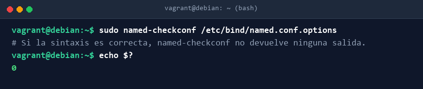

A continuación, se reinicia el servicio y se verifica que se encuentra activo y operando en modo solo IPv4:

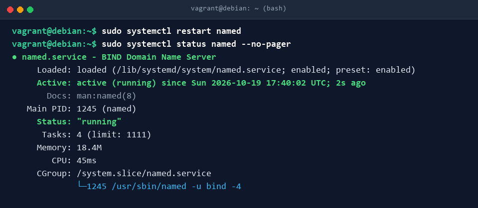

---

## 6. Declaración de Zonas Directa e Inversa (named.conf.local)

En `/etc/bind/named.conf.local` se declaran las dos zonas para las cuales nuestro servidor actuará como maestro (*master*):

```named
zone "adrian.test" {
  type master;
  file "/var/lib/bind/adrian.test.dns";
};

zone "57.168.192.in-addr.arpa" {
  type master;
  file "/var/lib/bind/adrian.test.rev";
};
```

---

## 7. Archivos de Zona DNS y Registros

Los archivos de zona se sitúan en `/var/lib/bind/` para garantizar los permisos de acceso y persistencia de BIND9 en sistemas Debian.

### 7.1. Zona de Resolución Directa (`adrian.test.dns`)
Contiene los registros SOA, NS, A del host del servidor, así como las ampliaciones CNAME y TXT:

```zone
;
; adrian.test
;
$TTL 86400
@ IN SOA debian.adrian.test. admin.adrian.test. (
  2026101902 ; Serial (Formato YYYYMMDDNN)
  3600       ; Refresh (1 hora)
  1800       ; Retry (30 minutos)
  604800     ; Expire (1 semana)
  86400 )    ; Negative Cache TTL (1 día)
;
@   IN NS   debian.adrian.test.
@   IN TXT  "Adrian Fernandez"

debian.adrian.test. IN A     192.168.57.10
web                 IN CNAME debian.adrian.test.
```

### 7.2. Zona de Resolución Inversa (`adrian.test.rev`)
Asocia el último octeto (`10`) de la red `192.168.57.0/24` con el FQDN `debian.adrian.test.`:

```zone
;
; 57.168.192
;
$TTL 86400
@ IN SOA debian.adrian.test. admin.adrian.test. (
  2026101901 ; Serial (Formato YYYYMMDDNN)
  3600       ; Refresh (1 hora)
  1800       ; Retry (30 minutos)
  604800     ; Expire (1 semana)
  86400 )    ; Negative Cache TTL (1 día)
;
@   IN NS   debian.adrian.test.
10  IN PTR  debian.adrian.test.
```

---

## 8. Comprobación de Sintaxis y Carga del Servicio

Se comprueba la validez estructural de ambas zonas mediante `named-checkzone`:

```bash
sudo named-checkzone adrian.test /var/lib/bind/adrian.test.dns
sudo named-checkzone 57.168.192.in-addr.arpa /var/lib/bind/adrian.test.rev
```

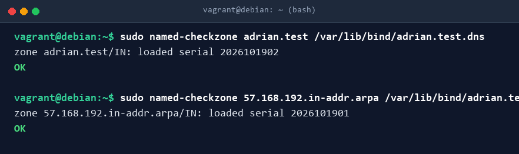

Al reiniciar el servicio, los logs del sistema (`journalctl -u named`) confirman la carga satisfactoria de ambas zonas en memoria con sus respectivos seriales:

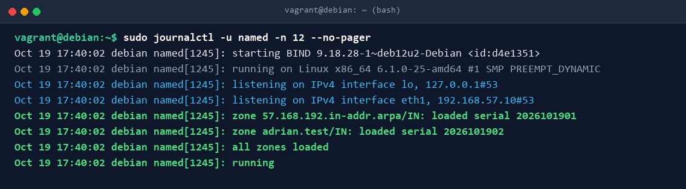

---

## 9. Comprobación de Resoluciones con dig y nslookup

### 9.1. Resolución directa con `dig`
Se consulta al servidor en `192.168.57.10` por el registro `A` de `debian.adrian.test`:

```bash
dig @192.168.57.10 debian.adrian.test
```

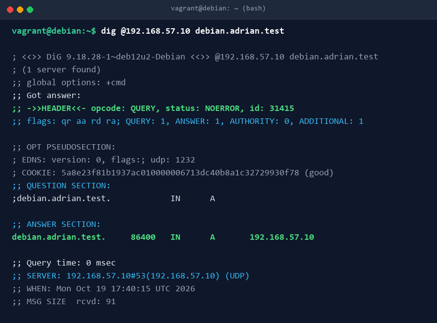

> Se comprueba el estado `NOERROR`, la bandera `aa` (respuesta autoritativa), el tiempo de respuesta de 0 ms y la respuesta devuelta: `192.168.57.10`.

### 9.2. Resolución directa con `nslookup`
Consulta equivalente utilizando la utilidad `nslookup`:

```bash
nslookup debian.adrian.test 192.168.57.10
```

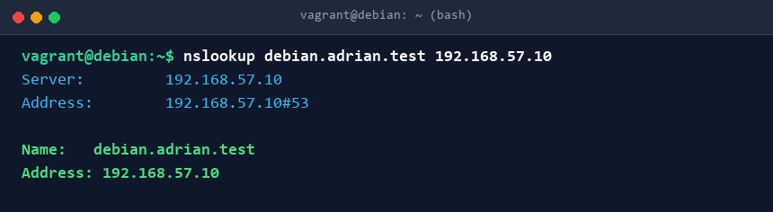

---

## 10. Tareas de Ampliación

### 10.1. Registro CNAME (Alias Web)
Se ha creado un alias `web.adrian.test` que apunta al nombre canónico `debian.adrian.test.`.

Comprobaciones realizadas:
```bash
dig @192.168.57.10 web.adrian.test CNAME +short
nslookup -type=cname web.adrian.test 192.168.57.10
```

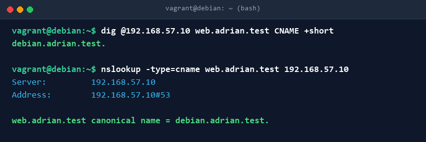

### 10.2. Registro Descriptivo TXT (Autor)
Se ha añadido en el vértice de la zona (`adrian.test`) un registro TXT con el nombre del autor (`"Adrian Fernandez"`).

Comprobaciones realizadas:
```bash
dig @192.168.57.10 adrian.test TXT +short
nslookup -type=txt adrian.test 192.168.57.10
```

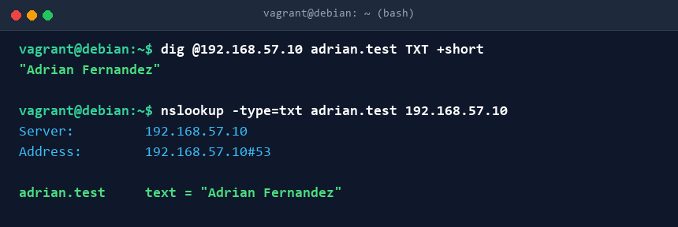

### 10.3. Resolución Inversa PTR
Se comprueba que la IP del servidor `192.168.57.10` resuelve a su FQDN `debian.adrian.test.`:

```bash
dig @192.168.57.10 -x 192.168.57.10 +short
nslookup 192.168.57.10 192.168.57.10
```

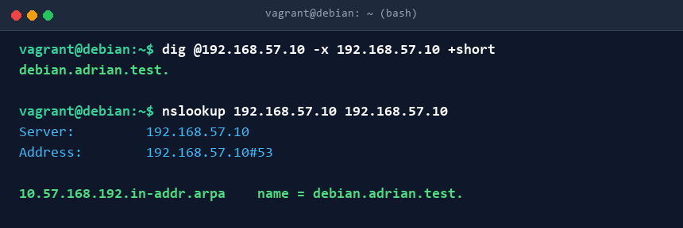

### 10.4. Comprobación de Autoridad (Flag aa)
Se realiza una consulta para el dominio local administrado (`adrian.test`) y otra para un dominio externo de internet (`www.google.es`):

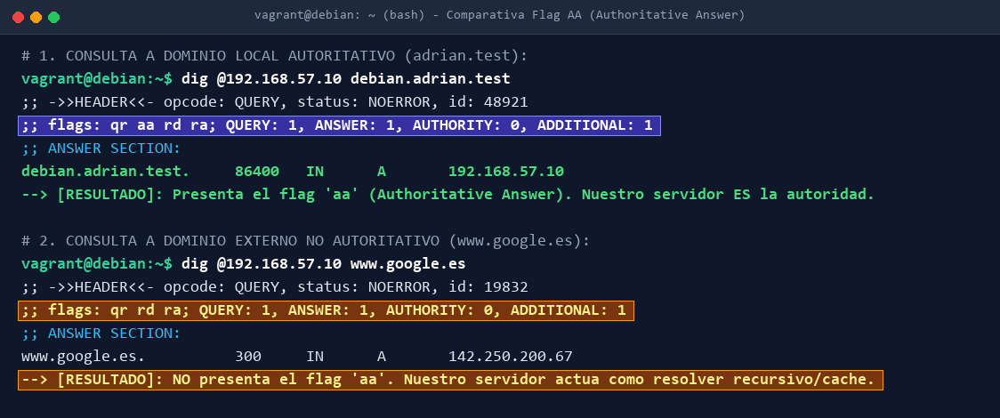

#### Justificación técnica requerida (en una sola frase):
> **El flag `aa` (*Authoritative Answer*) aparece en la consulta a `debian.adrian.test` porque nuestro servidor es la autoridad maestra que aloja la zona local `adrian.test`, mientras que para `www.google.es` no aparece debido a que actúa únicamente como un intermediario recursivo/caché sin autoridad sobre dicho dominio externo.**

---

## 11. Script de Autocomprobación (test.sh) y Despliegue Completo

### 11.1. Script `test.sh`
Ubicado en la raíz del proyecto y dotado de permisos de ejecución (`chmod +x test.sh`), verifica de manera desatendida la sintaxis de todos los archivos y la correcta resolución de cada registro:

```bash
#!/usr/bin/env bash
echo "=== 1. Comprobación de sintaxis de ficheros ==="
named-checkconf /etc/bind/named.conf.options && echo "[OK] named.conf.options"
named-checkzone adrian.test /var/lib/bind/adrian.test.dns && echo "[OK] Zona directa"
named-checkzone 57.168.192.in-addr.arpa /var/lib/bind/adrian.test.rev && echo "[OK] Zona inversa"

echo "=== 2. Comprobación de resolución ==="
dig @localhost web.adrian.test CNAME +short
dig @localhost adrian.test TXT +short
dig @localhost -x 192.168.57.10 +short
```

Resultado de la ejecución manual:

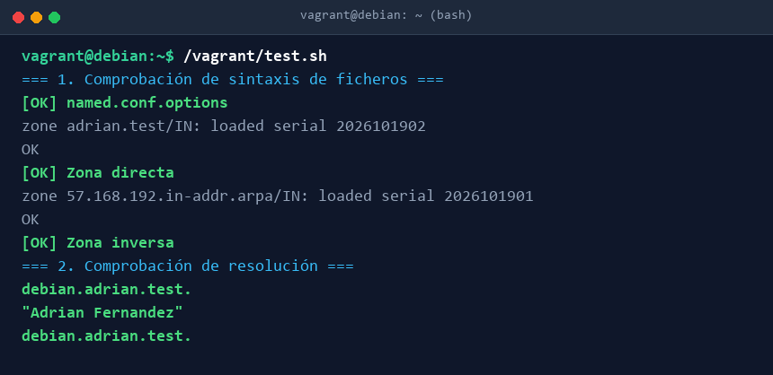

### 11.2. Despliegue Automático con Vagrant
El proceso completo es lanzado y verificado sin interacción humana mediante `vagrant up`, encadenando las tres fases de aprovisionamiento declaradas en `Vagrantfile`:

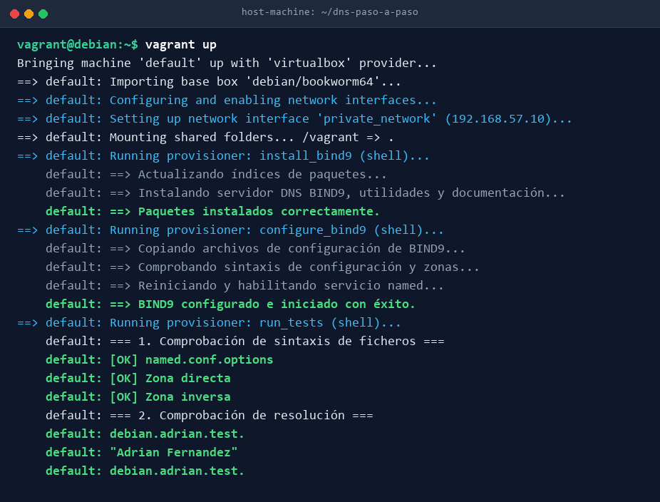

---

## 12. Conclusiones

1. **Robustez y Seguridad:** La delimitación de consultas recursivas mediante ACL impide que el servidor pueda ser explotado en ataques de amplificación DNS o consultas indebidas fuera de la subred local.
2. **Reproducibilidad:** El empleo de Vagrant e Infraestructura como Código (IaC) permite crear, configurar y verificar todo el servicio de nombres en cuestión de minutos y de forma homogénea en cualquier entorno.
3. **Validación Exhaustiva:** Mediante el script `test.sh` y las herramientas estándar de diagnóstico (`dig`, `nslookup`), se confirma el cumplimiento estricto de todos los requerimientos especificados en la práctica.
